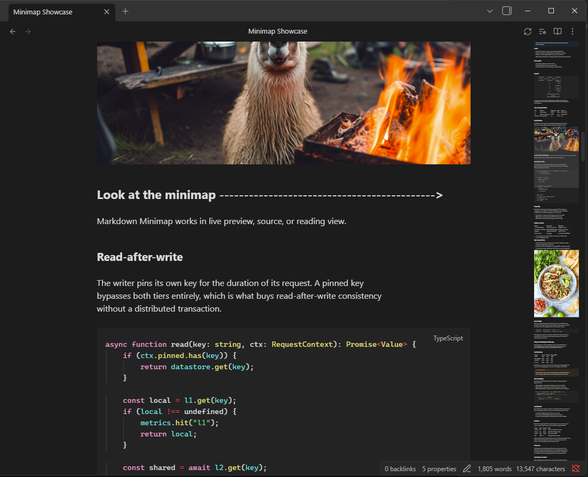

# 🗺️ Markdown Minimap

A minimap for your Markdown notes, inside the editor pane. Like the minimap in
a code editor, it gives you a scaled-down view of the whole note so you can see
its shape and jump anywhere in it.



## Why this one

Most minimap implementations clone the editor's DOM, which means they only ever
capture the part of the note that is currently on screen — Obsidian virtualizes
long notes, so past a certain length the minimap stops being a usable scrollbar.

Markdown Minimap renders the whole note independently, and spends most of its
effort on a harder problem: making the minimap agree with the note. The panel is
laid out at the note's own text width, margins, line height and font, and the
scroll position is mapped through anchors shared by both, rather than by
scaling the document by a single ratio. On a 14,000-word note that is the
difference between the viewport marker landing where you expect and landing 150
pixels away.

## ✨ Features

- 🔎 **Whole-note view** at any length, not just the rendered portion
- 🖱️ **Click or drag** anywhere in the minimap to jump there
- 🖲️ **Scroll wheel** over the minimap scrolls the note
- 🎯 **Mode-aware** — Live Preview, Source and Reading each get a faithful map
- 🎨 **Code blocks in colour**, highlighted by language in every mode
- 🪗 **Follows your folds** — collapsed sections and properties collapse too
- 🌓 **Follows your theme**, including custom fonts, heading sizes and snippets
- 🔁 **Per-note toggle** and refresh, from the note header or the command palette
- 📱 **Per-device switch** — turn it off on your phone without touching your desktop
- 📏 **Resizes** with the pane

## 📦 Installation

### From Community Plugins

`Settings` → `Community Plugins` → `Browse` → search for **Markdown Minimap** →
`Install`, then `Enable`.

### Manually

Download `main.js`, `manifest.json` and `styles.css` from the
[latest release](https://github.com/Nymbo/Markdown-Minimap/releases) and put
them in `<your vault>/.obsidian/plugins/markdown-minimap/`.

## 🧪 Usage

Open any note and the minimap appears at the right edge of the pane.

- **Click** anywhere on it to jump to what is drawn there; keep the button down
  to carry on dragging from where it landed
- **Drag** the viewport marker to scroll continuously
- **Scroll** over it with the wheel to scroll the note
- **Toggle** it per note with the button in the note header, or bind
  `Toggle minimap for current note` to a hotkey

The viewport marker has three states, mirroring a code editor: barely visible at
rest, legible when the pointer is over the minimap, and strongest while you are
dragging it.

## ⚙️ Settings

| Setting | What it does |
| --- | --- |
| Disable on this device | Hides the minimap on this device only. Stored outside the synced settings file, so your phone and your desktop can disagree |
| Enable by default | Whether new notes open with the minimap shown |
| Scale | Size of the minimap, 0.05–0.3 of actual size |
| Opacity | How solid the minimap is. 1 (the default) is fully opaque; lower values fade the whole minimap so the note shows through |
| Tint the minimap | Off by default. Gives the minimap a light wash of the theme's text colour so it stands apart from the note |
| Slider opacity | Viewport marker opacity while hovering the minimap; the dragging state scales from it |
| Idle slider opacity | Viewport marker opacity the rest of the time; set it to 0 to hide the marker until you hover |
| Top / bottom offset | Clearance for plugin toolbars or bottom chrome |
| Scrollbar gap | Distance between the minimap and the editor's scrollbar |
| Minimum viewport height | Floor for the viewport marker, so it stays grabbable in long notes |
| Make room for the minimap | Moves the note's text so the space either side of it stays even once the minimap has taken its strip. On by default |
| Center on click | Whether clicking the minimap centres the viewport on that point, or puts it at the top. Dragging the marker is unaffected |

### 💡 Giving the minimap room

**Make room for the minimap** is on by default. It measures the gap on either
side of the text — from the pane's left edge, and from the text to the minimap —
and shifts by half their difference, so the two come out equal at any zoom, font
size or screen. There is no number to type in and no unit to get wrong.

The text moves into the file margin as well as the readable line length margin,
and it is never pushed past the pane's own left edge. On a narrow pane there may
not be enough room to make the gaps fully equal; the text moves as far as it can
without being clipped, so it can still end up partly under the minimap. A wider
pane, `Settings` → `Editor` → `Readable line length`, or a smaller **Scale**
each give it more to work with.

Thanks to [@2590812378](https://github.com/Nymbo/Markdown-Minimap/issues/3) for
suggesting this, originally as a CSS snippet, and for the follow-ups that led to
it being computed rather than typed in by hand and then measured against the
pane rather than the text box.

## 📌 How it works

Most of the work in this plugin is in making the minimap and the note agree.
These are the parts worth knowing about.

**Whole-note rendering.** Obsidian virtualizes long notes, so a minimap built by
cloning the editor's DOM only ever sees the visible portion. Markdown Minimap
renders the note's full source separately, with no hidden helper views and no
iframes.

**Faithful layout.** The panel uses the note's own text width, top margin, line
height and font size, so lines wrap where they wrap in the note rather than at
the pane's full width.

**One panel, faded as a whole.** Opacity is the panel's own, not its
background's. A background alpha leaves the map's text and images at full
strength while the gaps between them go see-through, which reads as somebody
else's block sitting over the note; `opacity` is the only property that reaches
the rendered copy, since a background colour cannot touch its children. It is
solid by default. The optional tint is a wash of the theme's text colour rather
than of the pane's own background: the pane's colour is already behind it, and a colour
blended with itself is itself at any alpha, which is what made the setting look
broken — the slider moved and nothing changed. A text-colour wash contrasts
either way round, paler on a dark theme and darker on a light one, so the panel
still reads as a panel at full opacity. The colour is expressed as `color-mix`
and resolved by the browser, so whatever syntax a theme writes its colours in
still works, and a theme that defines neither variable leaves the panel untinted
rather than black.

**Source mode shows source.** With Live Preview off, Obsidian prints the file
verbatim. The minimap does the same — one element per source line, taking each
line's height from CodeMirror itself, rather than rendering Markdown the note
isn't showing. Line for line, this mode is exact. Source mode is still
highlighted in the editor, so the panel keeps those colours too: headings, links,
tags, quotes, code and emphasis all read as themselves. At a tenth of full size
the colour is most of what is left to navigate by.

**Code blocks are highlighted by language.** Reading view colours code by running
it through Prism, so the panel runs the same tokenizer over fenced blocks and
frontmatter and emits the same classes — meaning Source mode and Reading view
show a block in exactly the same colours, from your theme's own palette. A fence
with no language, or one Prism has no grammar for, stays plain text as before.

**Making room without a transform.** The text is moved clear of the minimap with
margins rather than a `translateX`. A transform makes the note's sizer the
containing block for everything absolutely positioned inside it, and Obsidian's
find-in-note overlay positions its match boxes in coordinates measured against
the scroller — so in Reading view the highlights landed a margin's width away
from the words they were marking. Two equal and opposite margins move the same
box the same distance, leave its width alone, and claim nothing.

**Properties.** Obsidian's Markdown renderer emits frontmatter as a hidden block
and never builds the properties widget, so properties would take up space in the
note and none in the minimap. The minimap reproduces them and pins the block to
the height they actually occupy — the widget, the raw YAML, or nothing,
according to what the note is showing.

**Code blocks.** A rendered `<pre>` is inset on both sides while an editor code
line is inset only on the left. Left alone that wraps wide code — ASCII diagrams
especially — one column early, which both scrambles them and inflates the note's
mapped height. The minimap matches the editor's box.

**Blank lines.** Markdown collapses consecutive blank lines when rendered. They
are re-inserted as inert spacers sized from CodeMirror's line blocks, so
deliberate whitespace survives.

**Collapsed sections.** A folded section takes no room in the note, so drawing
it would add height the note doesn't have and push everything below it out of
step. The minimap reads Obsidian's own fold state and folds to match, in every
mode — including Reading view, where the note's own sections are virtualized but
the panel's are not. Collapsing the properties works the same way. Folds that
don't hang off a heading, such as a list item, aren't mirrored in the rendered
modes; Source mode takes every line's height from CodeMirror, so it follows all
of them exactly.

**HTML in Live Preview.** Markdown runs an HTML block on to the next blank line,
so a code fence, heading, list or quote written directly under an HTML element
becomes part of it — Reading view draws a fenced example of an `<iframe>` as a
second, live iframe. Live Preview starts a new block there instead. In Live
Preview the panel does the same, so it draws what the editor shows; in Reading
view it keeps drawing what Reading view shows.

**The full scroll range.** Obsidian lets you scroll past the end of a note, and
its own scrollbar covers that space. The minimap mirrors it rather than leaving
it out, so the marker reaches the end of its track exactly when the editor does
and wheel distance keeps matching marker travel all the way down. That space is
scaled by the same ratio the panel achieves on the note's content, so it isn't
the one stretch of the panel drawn at a different scale from everything above
it — which is what used to make the marker change size on the approach to the
end of a long note.

**Redrawing only what changed.** Rendering a whole long note is the expensive
part — about half a second for 60,000 words — so the minimap avoids it. The note
is cut into sections at its headings and each is rendered on its own; an edit
redraws only the section it lands in, typically in about a millisecond, and
switching tabs redraws nothing. A cut is only made where it cannot change the
result: at a heading after a blank line, outside code, comments, math and raw
HTML. A note with footnotes or reference-style links, which are resolved across
the whole note, is never cut. Source mode does the same line by line.

**Scroll mapping.** Scaling the note by a single ratio assumes the minimap grows
at the same rate the note does, which it doesn't — small per-block differences
accumulate into hundreds of pixels over a long note. Instead both coordinate
spaces are anchored to positions that exist in each, and positions between them
are interpolated. Those positions are the note's headings and its images.

The headings are ATX headings that start a line and setext headings (text
underlined with `===` or `---`). A `#` inside a list item, a blockquote, a
callout or an embedded note renders as a heading but isn't one of the note's own
— Obsidian won't fold it or list it in the outline — so the panel skips those too
and the two lists stay in step. If they ever disagree in count anyway, Obsidian's
own heading index is consulted before the headings are left out, rather than
risking a wrong pairing.

The images matter most on a note made of screenshots. The panel draws an image
at its real height, but the editor only estimates the height of one it hasn't
displayed yet, so the two disagree by the whole difference until the next
anchor; anchoring each image keeps that inside a single image. Images are paired
with the panel's by the path they link to, in order, so an embed only one side
has — a missing attachment draws as an empty file — costs that one anchor rather
than all of them, and a note with no headings still has its images to go by. An
example inside inline code or a `%%` comment draws nothing, so it isn't counted. Several embeds on one line share a line, and so share the first of their
anchors. Reading view virtualizes its sections, so it uses the global ratio.

**Clicks name a position, not an offset.** In Live Preview and Source mode, a
click on the panel goes to what is drawn under the pointer: it asks the editor
for that position in the document and lets it scroll there itself, rather than
writing a scroll offset. An offset is only as good as the editor's height map,
and for an image it hasn't displayed yet that map holds a fraction of the real
height; on a note of screenshots a click computed as an offset landed several
images away. The editor measures as it scrolls, so a position lands where it was
asked to. Within a long wrapped paragraph the click goes to the row it was on,
not to the paragraph's first line.

On a long note the panel is taller than its track and slides as the note
scrolls, so after a click the content you clicked is centred in the editor (or
put at the top, with **Center on click** off) and the marker moves to it — it no
longer ends up under the pointer the way a
scrollbar's thumb would. Keep the button down and the rest of the gesture is an
ordinary marker drag, held from wherever the marker landed.

**A steady marker.** The marker's height is how much of the panel one screen of
the note takes up, averaged over the couple of screens around it rather than
read from the screen alone. Wherever the panel and the editor lay a block out
differently, a marker sized to the screen alone stretched and squashed as it
passed. The average only reaches as far as the editor has actually measured —
beyond that its heights are estimates, which would move it again. The marker is
placed within the screen's part of the panel so that it meets the top of its
track at the top of the note and the bottom at the end.

## 🛠️ Development

```bash
npm install
npm run build
```

`npm run dev` watches and rebuilds `main.js`. Source lives in `src/`:

| File | Contents |
| --- | --- |
| `main.ts` | Plugin lifecycle, workspace events, commands |
| `minimap.ts` | The minimap itself — rendering, measurement, scroll sync |
| `anchors.ts` | Heading extraction and the piecewise scroll mapping |
| `scroll-model.ts` | The scroll arithmetic, kept free of the DOM |
| `document-metrics.ts` | Measuring the note's layout and mirroring it onto the panel |
| `folds.ts` | Reading the note's fold state and folding the panel to match |
| `frontmatter.ts` | Reproducing the properties widget at the height it occupies |
| `source-view.ts` | Source-mode line classification, highlighting and line heights |
| `prism.ts` | Syntax highlighting for fenced code, via Obsidian's own Prism |
| `blank-lines.ts` | Blank-line runs, frontmatter and fence scanning |
| `sections.ts` | Cutting the note into sections that render independently |
| `pointer.ts` | Click, drag and wheel handling |
| `settings.ts` | Settings model and tab |
| `utils.ts` | Small shared helpers |

## 💡 Contributing

Bug reports and feature requests are welcome — open an
[issue](https://github.com/Nymbo/Markdown-Minimap/issues). Screenshots help a
lot for anything visual, as does the note's view mode, since the three modes
take different paths through the code.

## License

[MIT](LICENSE) © Nymbo.
